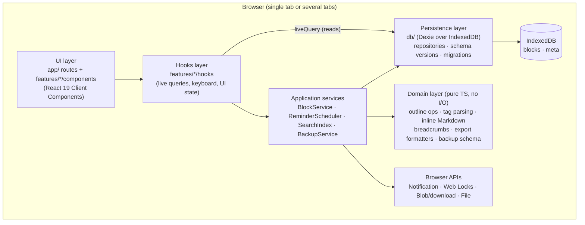

# Technical Specification: Ofelia — Personal Daily Journal & Tasks (MVP)

| | |
|---|---|
| **Version** | v1 |
| **Date** | 2026-10-12 |
| **Sources** | [MVP-Scope.md](MVP-Scope.md) (v2), [Product-Backlog.md](Product-Backlog.md) (v1) |
| **Audience** | Developers and AI coding agents |

> Reference document for implementation. It defines structure and contracts only. Anything not covered by the MVP scope or backlog is out of scope (see MVP-Scope §4).

---

## 1. High-level architecture

### 1.1 Summary

- **Client-only application.** No backend, no accounts, no network calls. All data lives in **IndexedDB** in the user's browser.
- **Next.js App Router with static export** (`output: 'export'`). The build produces static files that any static host (or `npx serve out`) can serve.
- The root layout is a Server Component; **every feature screen is a Client Component** because it depends on IndexedDB, keyboard input and browser APIs.
- **IndexedDB is the single source of truth.** The UI reads it through reactive live queries and writes it through domain commands. No duplicated client cache.
- **Desktop browsers only:** current Chrome, Edge, Firefox and Safari. No responsive or mobile layouts.

### 1.2 Layers



**Dependency rule:** `app → features → (services, domain, db, shared)`. `domain/` imports nothing from the other layers. Features import other features only through their `index.ts`.

### 1.3 Key technical decisions

| # | Topic | Decision | Rationale | Alternative rejected |
|---|---|---|---|---|
| 1 | Rendering | Next.js static export, client-rendered screens | No server data, no SEO need; static files are the simplest deployment | Node server / SSR (adds nothing without server data) |
| 2 | Routing of dynamic values | **Query parameters** (`/?date=2026-09-27`, `/tag?name=work`) | Static export cannot pre-render unknown dynamic segments such as `/journal/[date]` | Dynamic segments with `generateStaticParams` (dates are unbounded) |
| 3 | Persistence | **Dexie 4** over IndexedDB, with `dexie-react-hooks` (`useLiveQuery`) | Transactions (atomic restore), indexes, multi-entry index for tags, schema versioning, cross-tab reactivity | Raw `idb` (more hand-written plumbing) |
| 4 | Client UI state | **Zustand** store for ephemeral UI state only (focused block, edit mode, search dialog, banners) | Small, no provider tree; persistent state stays in IndexedDB | Redux Toolkit (too much ceremony for one developer) |
| 5 | Sibling ordering | **Fractional index keys** (`fractional-indexing` package), stored as `order: string` | Insert or move a block by writing one row; no renumbering of siblings | Integer positions (rewrite siblings on every move) |
| 6 | Inline Markdown | **Small in-house tokenizer** for bold, italic, links and inline code that returns React elements | Only four constructs; no `dangerouslySetInnerHTML`, so no XSS surface | `marked` + DOMPurify (bigger, needs HTML sanitising) |
| 7 | Search | **MiniSearch** in-memory index, built on startup and updated on every block change | Meets < 200 ms on 10,000 blocks with prefix matching | Linear scan (fine at 10k but no ranking/prefix support) |
| 8 | Backup validation | **Zod** schema for the JSON backup | Validate the whole file before touching data; types inferred from the schema | Hand-written checks |
| 9 | Zip creation | **fflate** | Small, fast, tree-shakable | JSZip (larger) |
| 10 | Reminder firing across tabs | **Web Locks API** (`navigator.locks`) elects one tab as the reminder leader | Prevents duplicate notifications when several tabs are open | BroadcastChannel leader election (more code) |
| 11 | IDs | `crypto.randomUUID()` | Native, collision-safe | Auto-increment keys (break on restore/merge) |
| 12 | Styling | CSS Modules + design tokens as CSS custom properties in `globals.css` | No runtime cost; fixed desktop layout; matches "HTML/CSS" stack | Tailwind (fine too; not needed for this size) |

### 1.4 Runtime flows

- **Startup:** open DB → run migrations → request `navigator.storage.persist()` → build search index → reminder scheduler checks missed reminders (US-19) → render today's page (US-03).
- **Edit:** keystroke → local editor state → debounced (≈300 ms) `BlockService.updateContent` → IndexedDB write → `useLiveQuery` re-renders subscribers → search index update. Structural operations (create, indent, move, delete, state change) write immediately. Every change must be persisted within 1 s (US-01).
- **Storage failure:** any rejected write (`QuotaExceededError`, `InvalidStateError`, DB unavailable) sets a persistent error banner in the UI store: "Changes are not being saved" (US-01).
- **Empty day:** a day with no blocks shows one **unsaved placeholder block**. It is persisted only when the user types, so empty days never count as "days with content".

---

## 2. Data models

All types live in `src/domain/types.ts`. Dates are stored as ISO 8601 strings; calendar days are stored as local-time `YYYY-MM-DD` strings.

### 2.1 Primitive types

| Type | Definition | Notes |
|---|---|---|
| `BlockId` | `string` (UUID v4) | From `crypto.randomUUID()` |
| `LocalDate` | `string`, format `YYYY-MM-DD` | Calendar day in the user's local time zone |
| `IsoDateTime` | `string`, ISO 8601 with offset/`Z` | Timestamps and reminder times |
| `TaskState` | `'TODO' \| 'DOING' \| 'DONE'` | Cycle: TODO → DOING → DONE → TODO |
| `OrderKey` | `string` | Fractional index key, compared lexicographically |
| `TagName` | `string`, lowercase, matches `[\p{L}\p{N}_-]+` | Normalised; `#Work` and `#work` are the same tag |

### 2.2 Entity: `Block` (table `blocks`)

The only persisted domain entity. Pages, tags and task lists are **derived** from blocks.

| Field | Type | Required | Description |
|---|---|---|---|
| `id` | `BlockId` | yes | Primary key |
| `pageDate` | `LocalDate` | yes | Journal day the block belongs to. Children always share their parent's `pageDate` |
| `parentId` | `BlockId \| null` | yes | `null` for top-level blocks |
| `order` | `OrderKey` | yes | Position among siblings (same `pageDate` + `parentId`) |
| `content` | `string` | yes | Raw Markdown text as typed, including `#tags` |
| `tags` | `TagName[]` | yes | Derived from `content` on every save; unique, lowercase. Not inherited by children |
| `task` | `TaskInfo \| null` | yes | `null` = plain note |
| `reminder` | `Reminder \| null` | yes | Only allowed when `task !== null` |
| `collapsed` | `boolean` | yes | Remembered collapse state. Ignored when the block has no children |
| `createdAt` | `IsoDateTime` | yes | Set once |
| `updatedAt` | `IsoDateTime` | yes | Updated on content, structure or state change |

**Value object `TaskInfo`**

| Field | Type | Description |
|---|---|---|
| `state` | `TaskState` | Current state |
| `stateChangedAt` | `IsoDateTime` | Timestamp of the last state change (US-15) |

**Value object `Reminder`**

| Field | Type | Description |
|---|---|---|
| `remindAt` | `IsoDateTime` | When the reminder is due |
| `firedAt` | `IsoDateTime \| null` | When the notification/banner was shown; `null` = pending |
| `dismissedAt` | `IsoDateTime \| null` | When the user dismissed it from the missed-reminders list |

**Invariants (enforced in `BlockService`, covered by unit tests)**

1. A block's parent exists and has the same `pageDate`.
2. No cycles in the parent chain.
3. `(pageDate, parentId, order)` is unique.
4. `tags` always equals `parseTags(content)`.
5. `reminder` is `null` when `task` is `null`. Turning a task back into a note clears its reminder.
6. Reminders on `DONE` tasks never fire.

**Dexie indexes:** `id` (primary), `pageDate`, `[pageDate+parentId]`, `parentId`, `*tags` (multi-entry), `task.state`, `reminder.remindAt`, `updatedAt`.

### 2.3 Entity: `MetaEntry` (table `meta`)

Key-value store for app-level state.

| Key | Value type | Description |
|---|---|---|
| `schemaVersion` | `number` | Data schema version of the stored data (US-02) |
| `lastOpenedAt` | `IsoDateTime` | Used to find reminders missed while the app was closed (US-19) |

### 2.4 Derived read models (not persisted)

| Model | Fields | Built from |
|---|---|---|
| `BlockNode` | `block: Block`, `children: BlockNode[]`, `depth: number` | Blocks of one `pageDate`, assembled into a tree sorted by `order` |
| `Breadcrumb` | `{ id: BlockId, label: string }[]` | Parent chain of a block (labels = plain-text content, truncated) |
| `TagSummary` | `name: TagName`, `count: number` | `*tags` index; sorted by count desc, then name asc. Unused tags disappear automatically (US-13) |
| `DaySummary` | `date: LocalDate`, `blockCount: number` | `pageDate` index; drives date-picker highlighting (US-04) |
| `BlockSearchResult` | `block: Block`, `breadcrumb: Breadcrumb`, `matches: TextRange[]`, `score: number` | Search index + filters (US-20, US-21) |
| `DueReminder` | `block: Block`, `breadcrumb: Breadcrumb` | Pending reminders with `remindAt <= now` and task not `DONE` |

### 2.5 Entity: `BackupFile` (JSON export / restore format)

| Field | Type | Description |
|---|---|---|
| `format` | `'ofelia-backup'` | Identifies the file type |
| `schemaVersion` | `number` | Data schema version at export time |
| `appVersion` | `string` | App version from `package.json` |
| `exportedAt` | `IsoDateTime` | Export time; also used in file name `ofelia-backup-YYYY-MM-DD-HHmm.json` |
| `data.blocks` | `Block[]` | All blocks, including hierarchy, tags, task states, reminders and `collapsed` |
| `data.meta` | `MetaEntry[]` | All meta entries |

Rules:
- Validated in full with Zod **before** any write. Older `schemaVersion` values are upgraded through `migrateBackup()`; newer versions are rejected with a clear error.
- Restore = one Dexie read-write transaction over `blocks` and `meta`: clear, then bulk insert. Any error aborts the transaction and leaves existing data unchanged (US-25).
- Export → restore must produce deep-equal data (round-trip test, US-24).

### 2.6 Markdown export format (US-23)

- One `YYYY-MM-DD.md` file per day with content, all inside `ofelia-export-YYYY-MM-DD.zip`.
- Each block is a bullet `- `; nesting uses 2-space (or tab) indentation per level.
- Task blocks are prefixed with `TODO `, `DOING ` or `DONE `. Tags remain inline as `#tag`. Content is written as-is (it is already Markdown).

---

## 3. Target folder structure

```
ofelia/
├── src/
│   ├── app/                              # Next.js App Router (routing only, thin)
│   │   ├── layout.tsx                    # Root layout (Server Component): html shell, fonts, AppProviders
│   │   ├── globals.css                   # Design tokens (CSS custom properties) + base styles
│   │   ├── page.tsx                      # Journal page  → /?date=YYYY-MM-DD&block=<id>
│   │   ├── tasks/page.tsx                # Task list     → /tasks?state=TODO&tag=work
│   │   ├── tags/page.tsx                 # Tag list      → /tags
│   │   ├── tag/page.tsx                  # Tag page      → /tag?name=work
│   │   ├── data/page.tsx                 # Export / restore
│   │   └── not-found.tsx
│   │
│   ├── features/                         # One folder per epic; public API via index.ts
│   │   ├── journal/                      # E2: day navigation, date picker, page title
│   │   │   ├── components/
│   │   │   ├── hooks/
│   │   │   └── index.ts
│   │   ├── outline/                      # E3: block tree, block editor, keymap, collapse, delete dialog
│   │   │   ├── components/
│   │   │   ├── hooks/
│   │   │   ├── keymap.ts
│   │   │   └── index.ts
│   │   ├── tags/                         # E4: tag chips, tag page, tag list
│   │   ├── tasks/                        # E5: state marker, task list view, filters
│   │   ├── reminders/                    # E6: picker, scheduler, notifications, banner, missed list
│   │   ├── search/                       # E7: Ctrl+K dialog, filters, search index
│   │   └── backup/                       # E8: JSON export, Markdown zip export, restore flow
│   │
│   ├── services/                         # Application services (orchestrate domain + db + browser APIs)
│   │   ├── block-service.ts
│   │   ├── reminder-scheduler.ts
│   │   ├── search-index.ts
│   │   └── backup-service.ts
│   │
│   ├── domain/                           # Pure TypeScript: no React, no Dexie, no browser APIs
│   │   ├── types.ts                      # Entities and value objects (§2)
│   │   ├── outline.ts                    # Tree build, indent/outdent/move/delete calculations
│   │   ├── tags.ts                       # parseTags, normalizeTag
│   │   ├── inline-markdown.ts            # Tokenizer for bold/italic/link/code
│   │   ├── breadcrumb.ts
│   │   ├── task-state.ts                 # nextState()
│   │   ├── dates.ts                      # LocalDate helpers (today, add days, format title)
│   │   ├── markdown-export.ts            # Block tree → Markdown text
│   │   └── backup-schema.ts              # Zod schema, versions, migrateBackup()
│   │
│   ├── db/                               # Persistence (Dexie)
│   │   ├── database.ts                   # Dexie subclass, table definitions, versions/indexes
│   │   ├── migrations.ts                 # Upgrade functions per schema version
│   │   ├── block-repository.ts
│   │   └── meta-repository.ts
│   │
│   ├── shared/
│   │   ├── ui/                           # Button, Dialog (<dialog>), Banner, DatePicker, Chip, Kbd
│   │   ├── hooks/                        # useHotkey, useDebouncedCallback
│   │   ├── store/ui-store.ts             # Zustand: ephemeral UI state (§4.4)
│   │   └── providers/AppProviders.tsx    # 'use client': DB bootstrap, scheduler, search index, error banner
│   │
│   └── test/
│       ├── setup.ts                      # RTL + fake-indexeddb + jest-dom matchers
│       └── factories.ts                  # Block/Backup builders for tests
│
├── e2e/                                  # Playwright specs (one per epic) + fixtures
├── public/
├── next.config.ts                        # output: 'export'
├── tsconfig.json                         # strict: true, noUncheckedIndexedAccess: true, paths "@/*" → "src/*"
├── vitest.config.ts                      # environment: jsdom
├── playwright.config.ts                  # Chromium, Firefox, WebKit (desktop)
├── eslint.config.mjs                     # Flat config; enforces layer import boundaries
└── package.json
```

Each feature folder follows the same internal layout: `components/`, `hooks/`, optional `model/` (feature-local pure logic), and `index.ts` (the only import entry point for other features and `app/`).

### 3.1 Routes

| Route | Screen | Query parameters | Stories |
|---|---|---|---|
| `/` | Journal day page | `date?: LocalDate` (default: today), `block?: BlockId` (focus + highlight) | US-03 – US-10, US-22 |
| `/tasks` | Open tasks, grouped by state | `state?: 'TODO' \| 'DOING'`, `tag?: TagName` | US-16 |
| `/tags` | Tag list with counts | — | US-13 |
| `/tag` | All blocks with one tag, grouped by day (newest first) | `name: TagName` | US-12 |
| `/data` | JSON export, Markdown export, restore | — | US-23 – US-25 |
| *(overlay)* | Search dialog, opened with `Ctrl/Cmd+K` from any route | — | US-20 – US-22 |
| *(overlay)* | Missed reminders list, shown on launch when needed | — | US-19 |

Pages that read `useSearchParams()` must wrap the client screen in `<Suspense>` (required for static export).

---

## 4. Internal interfaces (client-side "API")

There are no HTTP endpoints. The contracts below are the internal API between layers. Signatures only; all writes return `Promise` and reject with a typed `StorageError` on failure.

### 4.1 Repositories (`src/db/`)

```ts
interface BlockRepository {
  getById(id: BlockId): Promise<Block | undefined>;
  getByPage(pageDate: LocalDate): Promise<Block[]>;
  getChildren(parentId: BlockId): Promise<Block[]>;
  getDescendants(id: BlockId): Promise<Block[]>;
  getByTag(tag: TagName): Promise<Block[]>;
  getOpenTasks(): Promise<Block[]>;                       // task.state in TODO | DOING
  getDueReminders(now: IsoDateTime): Promise<Block[]>;    // pending, not DONE, remindAt <= now
  getAll(): Promise<Block[]>;
  listDaysWithContent(): Promise<DaySummary[]>;
  listTagSummaries(): Promise<TagSummary[]>;
  put(block: Block): Promise<void>;
  bulkPut(blocks: Block[]): Promise<void>;
  bulkDelete(ids: BlockId[]): Promise<void>;
}

interface MetaRepository {
  get<K extends MetaKey>(key: K): Promise<MetaValue<K> | undefined>;
  set<K extends MetaKey>(key: K, value: MetaValue<K>): Promise<void>;
  getAll(): Promise<MetaEntry[]>;
}
```

### 4.2 Domain commands (`BlockService`)

Each command runs in one Dexie transaction and keeps the invariants in §2.2.

| Command | Signature | Stories |
|---|---|---|
| Create | `createBlock(input: { pageDate: LocalDate; afterId?: BlockId; parentId?: BlockId \| null; content?: string }): Promise<Block>` | US-05 |
| Edit content | `updateContent(id: BlockId, content: string): Promise<void>` *(re-parses tags)* | US-05, US-06, US-11 |
| Indent | `indent(id: BlockId): Promise<void>` *(no-op on the first sibling)* | US-07 |
| Outdent | `outdent(id: BlockId): Promise<void>` *(children move with the block)* | US-07 |
| Move | `moveUp(id: BlockId): Promise<void>` / `moveDown(id: BlockId): Promise<void>` | US-09 |
| Collapse | `setCollapsed(id: BlockId, collapsed: boolean): Promise<void>` | US-08 |
| Expand path | `expandAncestors(id: BlockId): Promise<void>` | US-22 |
| Count | `countDescendants(id: BlockId): Promise<number>` *(for the delete confirmation)* | US-10 |
| Delete | `deleteBlock(id: BlockId): Promise<void>` *(block + all descendants)* | US-05, US-10 |
| To task | `convertToTask(id: BlockId): Promise<void>` *(state = TODO)* | US-14 |
| To note | `convertToNote(id: BlockId): Promise<void>` *(clears task and reminder)* | US-14 |
| Cycle state | `cycleTaskState(id: BlockId): Promise<void>` | US-15, US-16 |
| Set state | `setTaskState(id: BlockId, state: TaskState): Promise<void>` | US-19 |
| Reminder | `setReminder(id: BlockId, remindAt: IsoDateTime): Promise<void>` / `removeReminder(id: BlockId): Promise<void>` | US-17 |
| Reminder status | `markReminderFired(id: BlockId, at: IsoDateTime): Promise<void>` / `dismissReminder(id: BlockId): Promise<void>` | US-18, US-19 |

### 4.3 Other services

```ts
interface SearchIndex {
  build(blocks: Block[]): void;
  upsert(block: Block): void;
  remove(ids: BlockId[]): void;
  search(query: string, filters: SearchFilters, limit?: number): BlockSearchResult[];  // sync, < 200 ms @ 10k
}

interface SearchFilters {
  tags?: TagName[];
  type?: 'note' | 'task';
  states?: TaskState[];
  dateFrom?: LocalDate;
  dateTo?: LocalDate;
}

interface ReminderScheduler {
  start(): void;                          // acquires Web Lock "ofelia-reminders"; polls every 30 s and on visibilitychange
  stop(): void;
  checkMissed(since: IsoDateTime): Promise<DueReminder[]>;
  requestPermission(): Promise<NotificationPermission>;
}

interface BackupService {
  exportJson(): Promise<Blob>;                         // BackupFile, triggers download
  exportMarkdownZip(): Promise<Blob>;                  // one YYYY-MM-DD.md per day
  validate(file: File): Promise<ValidationResult>;     // no writes
  restore(backup: BackupFile): Promise<void>;          // atomic replace-all
}

type ValidationResult =
  | { ok: true; backup: BackupFile; blockCount: number }
  | { ok: false; error: 'invalid-json' | 'unknown-format' | 'unsupported-version' | 'schema-mismatch'; message: string };
```

### 4.4 Reactive read hooks and UI state

| Hook | Returns | Used by |
|---|---|---|
| `usePageTree(date: LocalDate)` | `BlockNode[] \| undefined` | Journal page |
| `useDaysWithContent()` | `DaySummary[]` | Date picker |
| `useTagSummaries()` | `TagSummary[]` | Tag list |
| `useBlocksByTag(tag: TagName)` | `{ date: LocalDate; items: { block: Block; breadcrumb: Breadcrumb }[] }[]` | Tag page |
| `useOpenTasks(filters)` | grouped by `TaskState`, each item with date + breadcrumb | Task list |
| `useSearch(query, filters)` | `BlockSearchResult[]` | Search dialog |
| `useDueReminders()` | `DueReminder[]` | Banner, missed list |

`undefined` means "loading" (from `useLiveQuery`); screens render a skeleton for it.

**Ephemeral UI store (Zustand, not persisted):**

| Field | Type | Purpose |
|---|---|---|
| `focusedBlockId` | `BlockId \| null` | Keyboard focus in the outline |
| `editingBlockId` | `BlockId \| null` | Block showing raw Markdown (US-06) |
| `highlightedBlockId` | `BlockId \| null` | Temporary highlight after a jump (US-22) |
| `isSearchOpen` | `boolean` | Search dialog |
| `storageError` | `string \| null` | "Not saving" banner (US-01) |
| `reminderBanners` | `DueReminder[]` | In-app fallback when notifications are denied (US-18) |
| `pendingDelete` | `{ id: BlockId; count: number } \| null` | Delete confirmation dialog (US-10) |

### 4.5 Keyboard map (`features/outline/keymap.ts`)

| Key | Action | Story |
|---|---|---|
| `Enter` | New block below, focus it | US-05 |
| `Backspace` (empty block) | Delete block, focus end of previous block | US-05 |
| `Tab` / `Shift+Tab` | Indent / outdent | US-07 |
| `Alt+Shift+↑` / `Alt+Shift+↓` | Move block up / down with children | US-09 |
| `Ctrl/Cmd+↑` / `Ctrl/Cmd+↓` | Collapse / expand | US-08 |
| `Ctrl/Cmd+Enter` | Note → TODO, then cycle state | US-14, US-15 |
| `Ctrl/Cmd+K` | Open search | US-20 |
| `Alt+←` / `Alt+→` / `Alt+T` | Previous day / next day / today | US-04 |
| `Escape` | Leave edit mode / close dialog | — |

---

## 5. Non-functional requirements → design

| Requirement | Design response | Verified by |
|---|---|---|
| Saved within 1 s, survives restart (US-01) | Debounced content writes (≈300 ms), immediate structural writes, `navigator.storage.persist()` | Playwright reload test |
| Search < 200 ms at 10,000 blocks (US-20) | In-memory MiniSearch, filters applied on results | Vitest perf test with 10k generated blocks |
| Responsive at 10 nesting levels (US-07) | Tree built once per page from one indexed query; memoised `BlockRow`; per-page rendering only | Vitest + manual profiling |
| Keyboard-first | Central keymap; all actions reachable without mouse; visible focus | RTL `user-event` + Playwright keyboard-only specs |
| Accessible outline | `role="tree"` / `treeitem` with `aria-level`, `aria-expanded`; `<dialog>` for confirmations | axe in Playwright |
| No XSS from notes | Inline Markdown rendered as React elements; links get `target="_blank" rel="noopener noreferrer"`, `http(s)`/`mailto` only | Unit tests on tokenizer |
| Atomic restore (US-25) | Single Dexie transaction; validation before transaction | Unit test that injects a failure mid-restore |
| Forward-compatible backups | `schemaVersion` + `migrateBackup()` chain | Unit tests per version |

---

## 6. Testing strategy

| Level | Tool | Scope |
|---|---|---|
| Unit | Vitest | Everything in `domain/` (outline ops, tags, tokenizer, export formatters, backup schema/migrations) |
| Integration | Vitest + `fake-indexeddb` | Repositories, `BlockService` invariants, restore atomicity, export→restore round trip |
| Component | Vitest + React Testing Library + `user-event` | Outline keyboard behaviour, dialogs, filters, banners |
| End-to-end | Playwright (Chromium, Firefox, WebKit) | One spec per epic; persistence across reload; reminders with `page.clock` and `context.grantPermissions(['notifications'])` |
| Network mocking | MSW | **Not used in the MVP** — the app makes no HTTP requests. Keep it in the toolchain for future sync features |

---

## 7. Rules for AI coding agents

1. Stay inside the MVP scope. Do not add accounts, sync, mobile layouts, backlinks, priorities or other items from MVP-Scope §4.
2. Respect the layer rule in §1.2. `domain/` stays pure and fully unit-tested.
3. All persistence goes through `BlockService` / repositories. Components never call Dexie directly, except through the read hooks in §4.4.
4. Never store derived data other than `Block.tags`. Tag lists, breadcrumbs and day summaries are computed.
5. TypeScript `strict`; no `any`; use discriminated unions for UI states and results.
6. Every new interaction needs a keyboard path and an accessible name.
7. Any schema change bumps `schemaVersion` and adds both a Dexie migration and a `migrateBackup()` step, with tests.
8. Code, identifiers, comments and test names are in English.
9. Each story is done when it meets the backlog's acceptance criteria and the Definition of Done.
